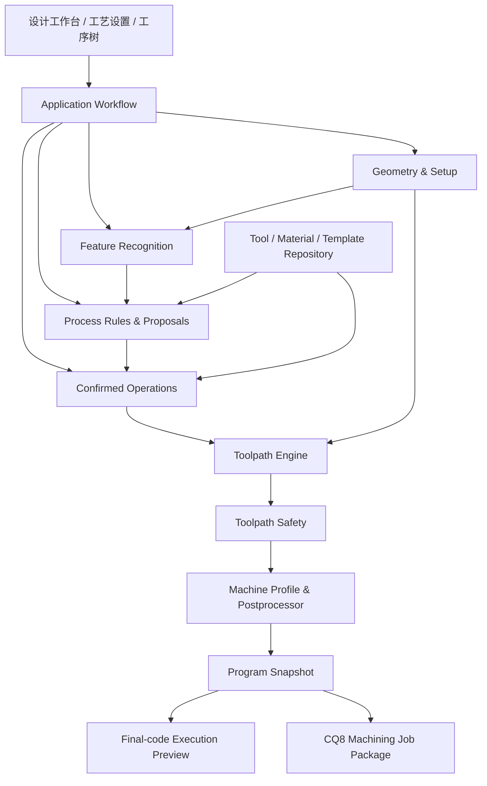

# CNEXT-CAM：DTM 参考架构与后续开发方案

日期：2026-08-25

## 1. 方案结论

DTM 的价值主要有三部分：成熟的功能覆盖、基于 Open CASCADE 的几何/特征处理思路，以及从工艺库到刀路、仿真和机床执行的完整数据流。CNEXT-CAM 应参考这些能力，但不复制其“大型界面控制器直接协调几何、工艺、数据库和设备”的结构。

目标方案采用以下原则：

1. STEP/B-Rep 是几何事实来源，屏幕坐标和网格包围盒不能作为生产刀路边界。
2. 特征识别只产生候选；工艺规则只产生建议；人工确认后才形成正式工序。
3. 工艺参数、刀路算法、后处理、安全验证和仿真分别负责单一职责。
4. 仿真读取最终控制器代码，不读取策略内部的另一份路径。
5. 恢复伪代码只用于提取算法意图、参数关系、拓扑条件和异常分支，新实现必须由测试证明。

## 2. DTM 架构中值得保留的部分

| DTM 能力 | CNEXT-CAM 对应设计 | 处理方式 |
|---|---|---|
| CatDesign 的工艺入口和工序编排 | MainWindow + 工作流服务 + OperationTree | 保留功能分组，不复制巨型控制器 |
| GeometryOcct / MdgOcct | GeometryScene、FeatureRecognizer、Machining Geometry | 拆分显示、识别与加工边界 |
| ModuleAutoHole | CompoundHoleRecognizer + AutoHolePlanningService | 识别和规则建议分开 |
| ModuleAutoSlotFrame | SlotFrameRecognizer + Pocket/Contour 策略 | 先恢复拓扑判断，再接刀路 |
| ModuleIntelligentChamfering | ChamferRecognizer + Chamfer Operation Proposal | 候选、过滤、确认、生成四阶段 |
| MyToolPath / MyToolArcPath | ToolpathEngine 下的独立策略 | 按算法族逐项重写和测试 |
| ContactPointSolver | SurfaceContactSolver | 仅在真实曲面和球头刀场景中启用 |
| G682Transform | SetupTransformService | 与 Machine Profile 的旋转轴约束结合 |
| DialogSort | Selection/Hole 排序服务 | 排序算法不放在对话框里 |
| GCodeParser / MillSimulation | 最终代码解析与 Execution Preview | 以控制器输出为唯一预览来源 |
| Excel/SQLite 工艺库 | 版本化 ProcessRule、ProcessTemplate、ToolRepository | 数据结构版本化并保存来源 |

## 3. 目标软件架构



### 3.1 界面层

- 顶部功能区按“文件、孔、螺纹、平面、槽/型腔、轮廓/倒角、曲面、自动模块、辅助、发送”组织。
- 左侧任务区只管理当前选择或识别流程。
- 中央视图区负责模型、毛坯、夹具、选择高亮和最终代码轨迹。
- 右侧属性区展示当前对象和工艺参数；工序树负责启停、排序、编辑、失效和重算。
- 对话框不保存算法状态；关闭或重开时从领域对象恢复。

### 3.2 应用工作流层

- 管理“选择 → 候选 → 参数 → 人工确认 → 工序 → 重算”的事务边界。
- 自动孔批量确认只占一个撤销步骤；部分失败时整批不提交。
- 负责工序依赖，例如清内角必须引用前开粗工序。

### 3.3 几何与 Setup 层

- 保存模型、稳定 GeometryRef、毛坯、夹具、Setup 和 G54-G59。
- 输出 Setup 相对的 Machining Geometry，而不是屏幕拾取点。
- 模型、Setup、毛坯或夹具变化时，使相关 Toolpath Result 失效。

### 3.4 特征识别层

- 孔：圆柱/圆锥面、同轴层级、入口/底面、盲孔/通孔。
- 槽框：底面、侧壁、自由边、闭合性、孤岛和保护面。
- 倒角/圆角：相邻面、宽度、角度、曲面类型和干涉。
- 识别结果必须包含置信、警告和拒绝原因，不能直接生成 G 代码。

### 3.5 工艺规则与资料层

- ProcessRule 根据 Recognized Feature、材料、刀具和机床能力生成 Operation Proposal。
- ProcessTemplate 只复制建议值；修改模板不静默改变已确认工序。
- 参数来源顺序：系统默认 < 材料模板 < 刀具模板 < 识别/模块规则 < 人工覆盖。
- 公式使用受限表达式树，禁止脚本执行。

### 3.6 刀路算法层

按算法族组织，不按界面按钮复制代码：

- Hole：固定循环、孔倒角、镗孔、攻牙、螺纹铣。
- Area Clearing：平面、型腔、槽、环形、孤岛、动态铣。
- Contour：开放/闭合轮廓、倒角、清内角、刻字和空间曲线。
- Surface：斜面、圆角、3D 倒角、自由曲面。
- Linking：进刀、退刀、抬刀、跨特征移动和夹具避让。

每个策略统一提供参数 Schema、默认值、校验、估算和 Toolpath Result。

### 3.7 后处理、安全与仿真

- Toolpath Result 是控制器无关的加工运动；Fanuc、Siemens、CQ8 的表达差异只存在于后处理层。
- 安全检查覆盖 Setup、刀具、刀具包络、有效刃长、快速移动、固定循环、模态状态和程序结束。
- Execution Preview 必须解析最终控制器代码，保证显示和实际输出一致。

## 4. 关键数据流

```text
STEP 模型
  → Setup/毛坯/夹具确认
  → 特征识别或人工选择
  → Recognized Feature
  → ProcessRule 匹配
  → Operation Proposal
  → 人工确认
  → Machining Operation
  → Toolpath Result
  → 安全验证
  → 后处理
  → Program Snapshot
  → 最终代码仿真 / CQ8 作业包
```

## 5. 当前能力状态

### 已建立的架构基础

- 稳定几何引用、孔选择会话和串联选择控制器。
- 参数 Schema、参数来源、OperationFactory 和项目持久化。
- 工序有效/过期/错误状态、重算和生成安全门。
- G73、G86、受限内螺纹铣、环形/单孤岛、二维倒角、二维斜面、自动孔单层子集。
- 矩形闭合型腔清内角安全子集和前工序依赖。

### 仍需完善

- 多层孔、沉头孔和复合孔规则。
- 槽框拓扑识别与保护面。
- 动态铣圆槽、复杂岛屿和一般清角。
- 智能倒角识别到安全刀路。
- 3D 斜面、圆角、3D 倒角和自由曲面。
- G68.2 倾斜工作平面和接触点求解。

## 6. 后续算法开发路线

### 阶段 A：复合孔闭环

目标：完成正面 Z 向同轴台阶孔和沉头孔。

- 恢复圆柱/圆锥层级和 0.001 mm 同轴组合逻辑。
- 建立 Compound Hole、HoleLayer 和稳定特征 ID。
- 规则生成打点、G81/G83、倒角/沉头的候选步骤。
- 人工确认后原子创建工序链。
- 验证每层刀径、深度、刃长、R 平面、贯穿余量和最终代码。

### 阶段 B：槽框识别基础

目标：把现有人工矩形策略扩展为可靠的槽/框 Recognized Feature。

- 面、边、点邻接图；底面和侧壁分类。
- 闭合/开放判断、自由端补线类型、孤岛识别。
- 建立保护面并排除穿过保护体的路径段。
- 先输出候选和 Machining Geometry，再复用现有槽/型腔策略。

### 阶段 C：二维刀路几何内核

目标：补齐多个策略共同依赖的可靠基础算法。

- 轮廓偏置、线/圆弧相交、自交清理。
- 点在多边形/线框内、包含关系和岛屿相减。
- 起点选择、反向、进退刀和路径连接。
- 用属性测试覆盖退化边、窄通道、相切、极小圆弧和多个岛屿。

### 阶段 D：动态铣与螺旋路径

目标：先完成圆槽安全子集，再扩展一般型腔。

- 阿基米德螺旋、反向螺旋和圆槽裁剪。
- 校验最小路径半径、径向吃刀、步距、进刀角和每层深度。
- 快速移动只能在安全高度发生；最终代码仿真不得越过边界。

### 阶段 E：智能倒角

目标：先实现识别和过滤，再接现有二维倒角策略。

- 分类平面、圆柱、圆锥、圆环和自由曲面。
- 计算相邻面、倒角宽度/角度、深度/长度/直径限制。
- 建立候选、过滤、人工确认、刀路四阶段状态。
- 干涉或保护面不确定时拒绝生成。

### 阶段 F：多面与三维加工基础

目标：在三轴正面能力稳定后再开放。

- G68.2 ZXZ 欧拉角、IJK 到姿态、多解和机床角度限制。
- 世界坐标、Setup、倾斜平面和机床坐标之间的可逆变换。
- SurfaceContactSolver 的距离/法向方程和中心差分雅可比。
- 以解析平面、圆柱、球面和受控 B-Spline 样例验证后，才开放 3D 路径。

## 7. 每个功能的完成标准

一个功能只有同时满足以下条件才能标为“已完成”：

1. 真实几何或经过确认的 Machining Geometry。
2. 参数 Schema、单位、默认值、范围和跨字段校验。
3. 合适刀具、刀径、有效刃长和机床能力验证。
4. Toolpath Result 不越过工件边界或保护区域。
5. 快速移动、进退刀、分层和换特征移动安全。
6. Fanuc/CQ8/Siemens 后处理行为明确。
7. 最终代码通过安全检查并由同一代码驱动仿真。
8. 工序、参数来源、几何引用和状态保存重开一致。
9. 自动功能经过人工确认后才提交。
10. 单元、集成、回归和代表性 STEP 模型验收通过。

## 8. 实施纪律

- 每次只推进一个纵向闭环，避免同时改识别、UI、策略和后处理。
- 先写失败测试，再实现最小安全子集。
- 不因恢复代码存在某个函数名就认定功能可用。
- 未验证能力在界面中保持禁用并显示原因。
- 冷却代码继续保持现状，直到单独立项验证机床行为。
- 每批行为变化写入项目进度和对应验收记录。
