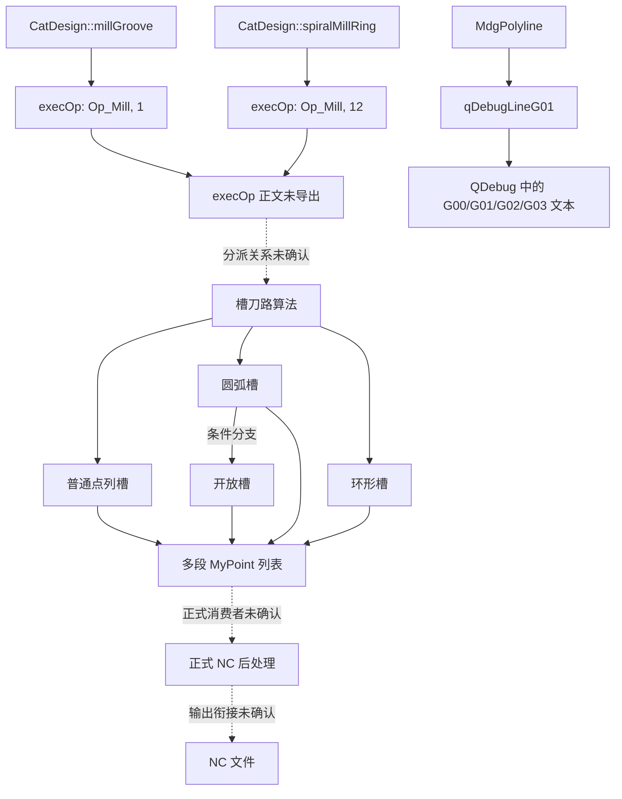

# 槽加工刀路与 G 代码生成代码整理

整理日期：2026-10-14。

## 1. 结论与范围

现有恢复代码包含普通槽、带圆弧槽、开放槽和环形槽的几何刀路算法；这些算法输出 `QList<QList<MyPoint>>`。另外发现将几何转换为 `G00/G01/G02/G03` 文本的调试函数，但尚未证明该函数参与正式加工 NC 输出。

**目前不能宣称“槽工艺入口到正式 NC 文件”的完整链路已还原。**界面分派函数和矩形槽宏程序生成函数仍只有符号索引，正式进给、主轴、刀补、安全高度等输出规则存在缺口。

本文与 [槽框识别算法整理](SLOT_RECOGNITION_ALGORITHM.md) 配套：前文回答“识别哪些几何”，本文回答“现有代码如何计算槽刀路，以及能确认到什么程度的 G 代码输出”。本次只整理文档，没有修改或重写算法。

证据等级：

- **已确认**：恢复代码中存在相应判断、调用或输出。
- **仅定位**：符号已找到，但正文未恢复或本次未展开核验。
- **未确认**：调用关系、参数语义或控制流尚有缺口。
- **重实现建议**：重新开发时建议采用的设计，不代表原程序现状。

恢复代码不是原作者源码，也不能直接编译。隐藏返回参数、结构布局和浮点调用约定存在失真，尤其不能仅按 `param_N` 或字段名称解释业务含义。

## 2. 源文件索引

下文使用文件编号加行号定位，例如 `C:L25998`。相对链接用于打开文件；行号对应本次整理时的版本，后续优先按符号名搜索。

| 编号 | 文件 | 内容 |
|---|---|---|
| A | [CatDesign_recovered.cpp](../src/controllers/CatDesign_recovered.cpp) | 槽加工界面入口 |
| B | [ModuleAutoSlotFrame_recovered.cpp](../src/features/ModuleAutoSlotFrame_recovered.cpp) | 自动槽框加工几何与参数列表 |
| C | [decompiled_core/decompiled_0001.cpp](../../dmtube/decompiled_core/decompiled_0001.cpp) | 点列槽算法 |
| D | [decompiled_core_large/decompiled_0001.cpp](../../dmtube/decompiled_core_large/decompiled_0001.cpp) | 圆弧槽算法、部分调试输出 |
| E | [decompiled_retry_payload/decompiled_0001.cpp](../../dmtube/decompiled_retry_payload/decompiled_0001.cpp) | 开放槽算法 |
| F | [decompiled_core_standard/decompiled_0003.cpp](../../dmtube/decompiled_core_standard/decompiled_0003.cpp) | 环形槽及 G 指令调试输出 |
| G | [DTM/decompiled_app/decompiled_0002.cpp](../../DTM/decompiled_app/decompiled_0002.cpp) | NC 编辑器保存 |
| H | [DTM/decompiled_app/function_inventory.csv](../../DTM/decompiled_app/function_inventory.csv) | 主程序函数恢复状态 |
| I | [dmtube/inventory/function_inventory.csv](../../dmtube/inventory/function_inventory.csv) | 算法 DLL 符号索引 |

## 3. 调用链与数据流

实线表示本次找到的调用或数据输出；虚线表示概念上的衔接方向，**不代表直接调用已经证实**。



注意：图中“槽刀路算法”是本文分组名称，不是已恢复的统一调度函数。

### 3.1 界面入口

**已确认：**

```text
CatDesign::millGroove(bool)
    → execOp(Op_Mill, QVariant(1), empty, empty, empty)

CatDesign::spiralMillRing(bool)
    → execOp(Op_Mill, QVariant(12), empty, empty, empty)
```

源码：`A:L4485–4527`、`L6376–6418`。两函数的 bool 参数在可见正文中未使用。伪调用中的 `&local_1c` 是返回 QVariant 的存储位置，不是加工参数。

**缺口：**`Nestube_Window::execOp` 地址 `101bf980`，大小 2107 字节，在 `I:L23048` 为 `inventory_only`。不能补造它到任何具体槽算法的直接调用。

### 3.2 自动槽框的输出边界

**已确认：**`ModuleAutoSlotFrame::generatePath` 输出 `QList<Shape3DShape*>`，其中构造 `ShapeFace/ShapeWire`，写入保护形状、补偿类别、铣外标记和加工深度。

源码：`B:L37493–37494`、`L38092–38093`、`L38354–38365`、`L38475–38482`、`L38927–38952`。

此函数的名字虽然叫 `generatePath`，但可见返回值并非 G 代码字符串，也不是本文槽刀路函数的 `MyPoint` 列表。其整数输入存在 `3/7 → 7`、`5 → 8`、其他默认 `1` 的模式转换，正式枚举名未确认。

`generateWorkList` 另行构造 `WorkParams/WorkParamsList`，见 `B:L39155–41417`；本次未发现它调用 `generatePath`，也未找到后者的可读消费者。两者不可画成已证实的连续调用链。

## 4. 数据与接口

以下是根据符号整理的可读接口摘要，不是可以直接编译的恢复头文件。

```cpp
// C:L25998
QList<QList<MyPoint>> MyToolPath::getMillingGroove(
    QList<gp_Pnt>, ProgramParams&, QString& error);

// D:L41557
QList<QList<MyPoint>> MyToolArcPath::getMillingGroove(
    MdgPolyline*, ProgramParams&, QString& error,
    QList<MdgPolyline*>, QList<MdgPolyline*>, MdgPolyline*);

// E:L7412
QList<QList<MyPoint>> MyToolArcPath::getMillingOpenGroove(
    MdgPolyline*, ProgramParams&, QString& error,
    QList<MdgPolyline*>, QList<MdgPolyline*>,
    const Message_ProgressRange&, MdgPolyline*);

// F:L10923
QList<QList<MyPoint>> MyToolArcPath::getSpiralMillingRing(
    QList<MdgPolyline*>, ProgramParams&, QString& error);
```

| 数据 | 已确认用途 | 不应擅自推断的内容 |
|---|---|---|
| `gp_Pnt` | 输入点坐标 | 不自动代表机床最终坐标 |
| `MdgPolyline` | 顶点、方向、圆弧 bulge、偏移等几何操作 | 附加列表不能一律命名为孤岛/保护边 |
| `ProgramParams` | 算法参数结构 | 恢复字段偏移可能错配，UI 映射需验证 |
| `MyPoint` | 输出坐标及 `bulges`、`speedType` 等标记 | `speedType=1` 不能直接等同 G01 |
| `QString&` | 错误消息输出 | 不等于返回 NC 文本 |

## 5. 普通点列槽算法

函数：`MyToolPath::getMillingGroove`，地址 `10475400`，`C:L25998`。

### 5.1 已确认阶段

1. 检查点数及首尾距离；闭合判断使用 `0.001`，但有模式允许绕过闭合要求。
2. 对切削量相关值作 `0.01` 阈值检查，模式值 `3` 有例外；另有模式值 `2` 分支。
3. 将点的 XY 构造成 `MdgPolyline`，保留原 Z，利用 `clockDir` 调整偏移方向。
4. 计算平面包围盒并调用 `polylineOffset`。
5. 根据偏移前后包围盒、短边尺寸及步距估算后续偏移次数。
6. 不同策略中继续偏移，调用斜向/螺旋相关辅助函数，最终构造分段 `MyPoint` 列表。

源码：`C:L26227–26331`、`L26381–26413`、`L27363`、`L27484`、`L27823`、`L28295–28313`。

### 5.2 可见辅助函数

| 调用 | 位置 | 本次确认范围 |
|---|---|---|
| `polylineOffset` | 26321–26331、26507、26921 等 | 轮廓偏移参与计算 |
| `getObliqueLines` | 27363 | 存在斜向相关分支，完整模式语义未核 |
| `getSpiralLines` | 27484 | 存在螺旋相关分支，未确认全部参数 |
| `getDividerLine` | 27823 | 某分支转交该函数 |
| `getObliquePnts` | 28295、28313 | 构造相关点序列 |

### 5.3 阅读辅助伪代码

```text
getMillingGroove(points, params):
    validatePointCount(points)
    if modeRequiresClosure(params):
        require endpointsWithinTolerance(points, 0.001)
    validateCuttingValueWithModeExceptions(params)

    outline = buildXYPolyline(points)
    referenceZ = originalZ(points)
    direction = clockDir(outline)
    offset = deriveOffsetWithDirection(params, direction)
    paths = []

    # 原函数有多个分支，不是所有模式都执行同一循环
    for step in UNRESOLVED_strategySchedule(params, outline):
        geometry = offsetOrBuildStrategyGeometry(step)
        require valid(geometry)
        pointsForStep = buildObliqueSpiralOrOtherPoints(geometry, referenceZ)
        appendMyPointSegments(paths, pointsForStep)
    return paths
```

`UNRESOLVED_*` 不可在重实现中用默认成功替代。完整分层公式和枚举对应关系尚未恢复。

## 6. 带圆弧槽算法

函数：`MyToolArcPath::getMillingGroove`，`D:L41557`。

**已确认：**连接输入多段线、统一相关轮廓 Z 值、检查闭合和模式，并在多处读取 bulge 与圆弧长度。特定条件组合会调用开放槽算法。

| 阶段 | 源码位置 |
|---|---|
| `ConnectMdgPolylines` | D:L41805 |
| 主轮廓及列表轮廓 `setSameZvalue` | D:L41837–41862 |
| 进入 `getMillingOpenGroove` 的条件组合 | D:L41864–41904 |
| 闭合/模式判断 | D:L42005、42122–42123 |
| 切削量相关阈值检查 | D:L42158–42160 |
| bulge 与圆弧长度处理 | D:L42572、42868、42901、42983、43158 |
| `getSinglePath` | D:L43290 |
| `getObliquePnts` | D:L43453、43468 |

**限制：**不能概括成“只要不闭合就调用开放槽”。入口条件还涉及顶点数、恢复字段 `spiralDir` 的值及 bulge。恢复字段 `depthStep`、`toolChamferAngle` 等存在布局疑点，不据其名称编造深度公式。

## 7. 开放槽算法

函数：`MyToolArcPath::getMillingOpenGroove`，地址 `1067f7f0`，`E:L7412`。

### 7.1 已确认阶段

- 闭合且相关列表为空的分支会回调普通 `getMillingGroove`，因此本函数并非仅处理未闭合轮廓。
- 将多段线转换为 OCC Wire，构造 Face，并执行 `BRepAlgoAPI_Cut`。
- 存在螺旋中心基线、轮廓连接、端点切向、轮廓偏移等处理。
- 使用形状距离检查及分段操作辅助处理边界。
- 将生成点列转换为 `MyPoint`，保存 bulge 和速度类型标记。
- 部分分支复用普通槽或 `getDividerLine`。

源码：`E:L8114–8179`、`L8182`、`L8344–8418`、`L8953`、`L9114`、`L9689–9690`、`L10270`、`L10431`、`L12119–12128`、`L12454–12456`、`L12673–12802`、`L13315–13346`。

### 7.2 阅读辅助伪代码

```text
getMillingOpenGroove(outline, params, auxiliaryGeometry):
    if closed(outline) and matchingAuxiliaryListsEmpty(...):
        return getMillingGroove(...)

    wire = convertPolylineToWire(outline)
    face = buildFace(wire, ...)
    region = applyBooleanCuts(face, auxiliaryGeometry)
    baseline = buildBaselineInApplicableBranch(region)

    paths = []
    for branch in UNRESOLVED_openGrooveStrategy(params):
        offsets = getOffsetLines(...)
        evaluateShapeDistancesAndSplitSegments(...)
        points = buildApplicableEntryAndCuttingPoints(...)
        appendMyPointsWithBulgeAndSpeedType(paths, points)
    return paths
```

布尔切割不应一律解释为扣除孤岛；附加几何列表的完整业务角色未从调用方确认。

## 8. 环形槽算法

函数：`MyToolArcPath::getSpiralMillingRing`，地址 `106bfa70`，`F:L10923`。

### 8.1 判断条件

| 条件 | 已确认行为 | 位置 |
|---|---|---|
| 输入数量 | 必须恰好两条路径 | F:L11019–11020 |
| 深度相关关系 | 不符合时报告 Z 方向余量过大 | F:L11061–11066 |
| 几何有效性 | 两路径非空且在 `0.001` 容差内闭合 | F:L11111–11117 |
| 内外关系 | 比较几何量、必要时交换，再判断包含 | F:L11119–11128 |
| 方向 | `clockDir` 不同则调整其中一条方向 | F:L11130–11133 |
| 高度 | 两轮廓首点 Z 差不超过 `0.001` | F:L11135–11142 |
| 间距 | 转 Wire 后求形状距离 | F:L11143–11155 |
| 刀具适配 | 结合两侧余量检查刀具尺寸，出现 `0.02` 容限 | F:L11187–11197 |

比较轮廓的虚函数返回量尚未确认是面积还是长度；首点高度一致也不等于已经验证全部轮廓共面。

### 8.2 路径构建

调用 `getOffsetLines`，处理 bulge 长度与分段，重设轮廓起点，再逐顶点构造包含 XY、Z、bulge 和速度标记的 `MyPoint`。

源码：`F:L11276`、`L11313`、`L11433–11517`、`L11619–11635`、`L11735–11748`。

```text
getSpiralMillingRing(contours, params):
    require count(contours) == 2
    validateDepthRelatedValues(params)
    require bothNonemptyAndClosed(contours, 0.001)
    outer, inner = orderUsingExistingGeometryComparison(contours)
    require line1ContainLine2(outer, inner, 0.001)
    alignContourDirections(outer, inner)
    require abs(firstZ(outer) - firstZ(inner)) <= 0.001
    separation = distanceBetweenWires(outer, inner)
    validateToolAndAllowances(separation, params)
    return buildOffsetArcAndEntrySegments(outer, inner, params)
```

上述最后一步为多处分支的摘要，不代表已经恢复完整偏移、进刀和分层公式。

## 9. 已确认的 G 指令转换：仅为调试输出

### 9.1 函数与输出对象

`MyToolArcPath::qDebugLineG01(MdgPolyline*, QString, bool)`，`F:L20296`。

它通过 `QDebug` 输出字符串，不能等同于正式 NC 后处理器。可见转换规则如下：

| 几何情况 | 输出 | 源码 |
|---|---|---|
| 首点 | `G00X...Y...Z...` | F:L20442、20467–20472 |
| 前一段 `abs(bulge) <= 0.001` 或首点 | `G01X...` 分支 | F:L20490–20572 |
| 有圆弧且 `isClockwise == false` | `G03` | F:L20608–20746 |
| 有圆弧且 `isClockwise == true` | `G02` | F:L20780–20904 |
| 圆弧附加数据 | `I`、`J`、`K0` 文本 | F:L20655–20660 |
| 布尔开关开启 | 附加 `N` 序号文本 | F:L20495 及对应分支 |

圆弧信息来自 `MyArcInfo(previousPoint, currentPoint, previousBulge)`，然后读取 `getInfo` 的结果。每轮保存当前点和 bulge 供下一段使用，见 `F:L20945–20953`。

**未确认：**不能仅凭输出字母确定 I/J 在正式控制系统中的坐标约定，也不能从明显失真的 `QString::number` 参数断言小数位数。

### 9.2 忠于可见行为的伪代码

```text
debugPolyline(polyline, numbered):
    previousPoint = unset
    previousBulge = initialValue
    for i, point in vertices(polyline):
        currentBulge = getBulge(polyline, i)
        if i == 0:
            debugPrint("G00", point)

        # 注意：这里不是 else-if，首点还会进入 G01 分支
        if i < 1 or abs(previousBulge) <= 0.001:
            debugPrint("G01", point, optionalNumber(numbered))
        else:
            arc = MyArcInfo(previousPoint, point, previousBulge).getInfo()
            code = "G02" if arc.isClockwise else "G03"
            debugPrint(code, point, arcFieldsIJK, optionalNumber(numbered))

        previousPoint = point
        previousBulge = currentBulge
```

首点可能先输出 G00、随后输出 G01，是本调试例程的可见行为；重实现正式后处理时不应未经分析照搬。

### 9.3 换刀、主轴和夹具的证据边界

另一个 `qDebugLineG01G02G03(QList<MyPoint>, EulerAngle, bool)` 调试重载中可见固定文本 `T01 M6`、`M03 S2500`，位置为 `D:L60214`、`L60389`。这不能证明正式加工使用固定刀号或固定转速。

`F:L22083`、`L22120`、`L22622–22661` 也有夹具相关代码和 `mcodeType` 分支，但仍属于调试输出。正式 F/S、G41/G42、坐标模式、安全高度和程序头尾模板尚未建立完整证据链。

## 10. 正式输出代码的缺口

### 10.1 矩形槽宏生成函数尚未导出

| 符号 | 地址 | 大小 | 状态 | 索引 |
|---|---|---|---|---|
| `CreateWorkMacro::getRectGroove` | `00b5b4b0` | 29775 字节 | `not_selected` | H:L53985 |
| `CreateWorkMacro::getMacroProgram` | `00b56820` | 524 字节 | `not_selected` | H:L53981 |

`getRectGroove` 是进一步核查矩形槽宏程序生成的重要入口，但当前仅凭名称不能还原其参数、分层、安全高度、刀补和进给输出规则，也不能确认其与前述多段线刀路算法的关系。

### 10.2 已找到的文件写出只是编辑器保存

`CatWork::ncEidtCommit`（原符号拼写如此），`G:L20371`，执行 `QFile::open`、`QsciScintilla::write` 和关闭文件；失败消息为 `write gcode into file %1 failed!`。

源码：`G:L20417–20423`。

该函数保存已有编辑文本，不能证明这些文本来自槽刀路生成。

### 10.3 后续恢复线索

以下均仅定位，尚未确认彼此调用关系：

| 符号 | 地址/位置 | 下一步需要核实 |
|---|---|---|
| `HdUi_Designer::createFeaturesPrograms` | `102c06e0`，I:L31974 | 工序如何进入程序生成 |
| `ConversionTools::ncCode2GncCode` | `103662b0`，I:L36804 | NC/GNC 转换职责 |
| `MdgOcct::setProgramText/getProgramText` | I:L57104–57105 | 文本消费者与真实实现；当前为 6 字节跳板 |

建议先恢复 `execOp` 和 `getRectGroove/getMacroProgram` 的正文及调用者，再追踪 `MyPoint` 正式消费者。不要用调试函数填补正式调用链。

## 11. 参数及错误处理索引

| 错误文本 | 位置示例 | 能确认的含义 |
|---|---|---|
| `Exists unclosed path !` | C:L26233 | 某模式要求闭合 |
| `Wrong offset!` | C:L26511；E:L11301 | 偏移失败分支 |
| `cal Error!` | C:L27150 | 计算失败，具体原因需结合分支 |
| `param error!` | C:L27847 | 参数失败分支 |
| `The oblique param error!` | C:L29027 | 斜向参数失败分支 |
| `The depthStep is too small!` | C:L29277；D:L43226 | 深度步距检查 |
| `Wrong cutting value setting !` | C:L29291；D:L42158–42160 | 切削量相关检查 |
| `Deal Convex Hull Error!` | D:L42224 | 相关几何处理失败 |
| `protect edge error` | E:L10729 | 保护边相关失败 |
| `Wrong cutMark!` | E:L10757 | 参数/标记检查，正式语义未核 |
| `The number of selected paths is not equal to 2 !` | F:L11020 | 环形槽路径数检查 |
| `Z dir depth mark is too large!` | F:L11066 | Z 方向参数关系检查 |
| `The tool radius is too large!` | F:L11197 | 刀具与可用间距关系检查 |

不能据错误字符串反推完整数学条件。恢复字段可能错配，尤其不要把可见的 `depthStep + toolChamferAngle` 一类表达式直接翻译成可靠加工公式。

## 12. 重实现建议

本节为重新开发设计，不是现有实现事实。

### 12.1 分离四层职责

```text
槽几何与工艺参数
    → 几何刀路规划
    → 有明确语义的运动段
    → 针对控制器的后处理
    → NC 文本与文件保存
```

运动段建议明确区分快移、直线切削、圆弧切削，并分别保存起终点、圆心或其他弧定义、进给类型和坐标系。不要让未解释的整数 `speedType` 承担全部含义。

### 12.2 建议的生成伪代码

```text
generateSlotProgram(feature, process, machineProfile):
    validateGeometryAndProcess(feature, process)
    paths = planSlotGeometry(feature, process)
    motions = buildEntryCuttingAndRetractMotions(paths, process)
    validateMotions(motions, feature, process)

    post = createPostprocessor(machineProfile)
    post.beginProgram(process)
    for motion in motions:
        post.emitMotion(motion)
    post.endProgram(process)
    return post.text()
```

正式后处理应在控制器约定明确后处理单位、坐标模式、圆弧平面及圆心约定、F/S、刀具和刀补、进退刀、安全高度、程序结束和数值格式。本次没有实现这些接口。

### 12.3 建议验证案例

- 普通闭合槽：轮廓偏移及最终加工范围正确。
- 开放槽：保护边不被越过，进退刀路径符合所选工艺。
- 带圆弧槽：圆弧端点、方向及半径一致，输出可被目标控制器解释。
- 环形槽：路径数、闭合、包含关系和刀具间距条件正确。
- 小步距及极限余量：错误分支明确，不产生空循环或无效路径。
- 深度不能整除步距：最终层到达目标深度且不超切；这是重实现验证要求，非当前公式已还原。
- 速度标记：快移、下刀和切削进给分别得到验证。
- 序列化：生成文本经独立解析回读后，运动几何与原刀路一致。
- 调试输出与正式输出：确认固定刀号、转速和首点重复指令没有被误用。

## 13. 相关算法入口：仅定位

| 符号 | 位置 |
|---|---|
| `MyToolPath::getIslandGroove` | C:L23005 |
| `MyToolPath::getOffsetMarkIslandGroove` | C:L32380 |
| `MyToolArcPath::getIslandGroove` | D:L33857 |
| `MyToolArcPath::getOffsetMarkIslandGroove` | D:L47799 |
| `MyToolArcPath::getSpiralCutGrooveLine` | F:L6169 |

本次未展开核验这些函数的完整算法，不能据其名称填补孤岛或螺旋进刀细节。

## 14. 本次核验范围

完成：入口、核心刀路算法、调试序列化、函数清单和文件保存的静态检索，并复核关键条件与源码位置。

未执行：恢复代码编译、DTM 实际刀路计算、NC 仿真及机床加工测试。本文提供的是代码导航和已确认逻辑，不是正式 G 代码生成链已经完整恢复或加工结果已经验证的报告。
