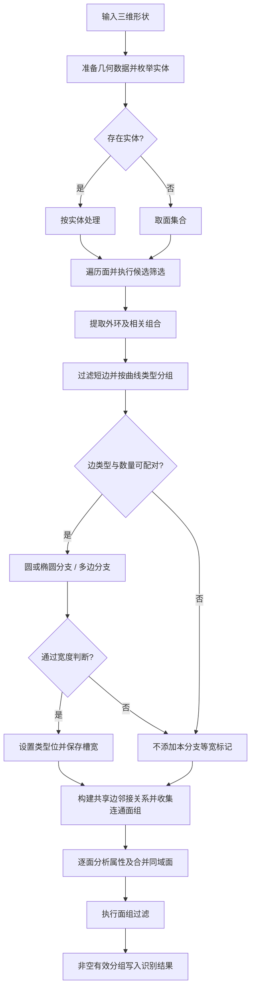
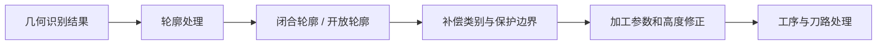

# 槽框识别算法整理

整理日期：2026-10-14  
适用对象：DTM / dmtube 三维模型自动槽框模块 `ModuleAutoSlotFrame`。

## 1. 范围与证据等级

本文整理现有文档和恢复代码中的槽框识别逻辑，覆盖候选面筛选、边界配对、槽宽计算、面组构建、面属性分析，以及后续保护边界和加工深度处理。本文不把槽框识别等同于刀路生成，也不声称覆盖所有槽型。

| 标记 | 含义 |
|---|---|
| **已确认** | 已在恢复的伪 C++ 中找到相应调用或判断；仍受反编译精度限制 |
| **未确认** | 调用关系、成员含义、枚举名称或算法细节缺少足够证据 |
| **重实现建议** | 为重新开发提出的设计，不代表原程序已经实现 |

主要资料：

- [源码恢复说明](../../README.md)：恢复文件不是原作者逐字源码，也不能直接编译。
- [设计界面源码说明](../README.md)：模块划分和恢复完整性。
- [设计界面功能文档](DESIGN_INTERFACE_FUNCTIONS.md)：7.5 槽类及 7.8 自动化模块；自动框操作细节标为“待更新”。
- [槽框模块恢复代码](../src/features/ModuleAutoSlotFrame_recovered.cpp)：本文算法细节的主要依据。

后文源码位置均指上述 `ModuleAutoSlotFrame_recovered.cpp`，简写为 `F:L行号`。行号对应整理时的文件版本；源码更新后应优先按符号名检索。链接定位到文件，行号另行列出，避免依赖 Markdown 阅读器对代码行跳转的支持。

## 2. 总体原理与输入输出

**已确认：**识别以三维 BRep 面、边和拓扑关系为基础，结合面法向、曲线类型、局部切向、边间距及共享边邻接关系形成槽框面组。并非仅按二维长宽比识别矩形槽。

| 项目 | 已确认内容 | 限制 |
|---|---|---|
| 选择输入 | `setSelectedShapes` 接收选中形状集合 | 后台 lambda 未展开，未证明它直接调用 `analyShape` |
| 几何分析输入 | `analyShape` 接收形状和进度对象 | 不是可直接使用的重建接口声明 |
| 坐标参照 | 多处使用 `gp::DZ()` 及 XY 投影关系 | 不能据此保证任意姿态模型无需坐标预处理 |
| 容差来源 | 控件数值或 `AppGlobal::getTolerance(..., Tol_Panel)` | 控件业务名、单位及部分成员真实名称未恢复 |
| 识别结果 | 带属性的 `ShapeFace` 分组/映射 | 不是最终刀路；完整结构定义尚未还原 |
| 附加属性 | 槽宽、面类型位、横向宽度、坡度、圆角及补偿信息 | 部分类型位没有正式枚举名 |

源码：`F:L53482`、`L53579–53589`、`L6994`、`L11111–11117`。

## 3. 流程图

### 3.1 已确认的主分析阶段

下图是 `analyShape` 的阶段摘要，省略内部支路与失败清理，不表示逐语句等价控制流。



**边界：**等宽分支失败不应直接解释为“整个槽不存在”；它首先意味着该分支没有设置相应标记和槽宽。

### 3.2 识别与后续加工处理的职责关系

此图是职责划分，不是已经证明的逐函数调用链。



## 4. 主流程判断条件

### 4.1 几何准备

**已确认：**代码根据 `getAlignedRotateCopy` 相关状态执行清理/网格化处理，随后枚举 `TopAbs_SOLID`；没有实体时取 `TopAbs_FACE`。

源码：`F:L7338–7357`。

**未确认：**网格化参数存在明显反编译失真，不能将恢复表达式直接作为可运行参数。

### 4.2 候选面法向筛选

**已确认：**在一个候选分支中，取首条边参数区间中点，求面法向，与正 Z 轴计算夹角：

```text
t_mid = (t_first + t_last) / 2
n = GetNormalToSurface(face, edge, t_mid)
θ = angle(n, Z)

通过该法向条件 ⇔ θ ≤ εθ 或 π − θ ≤ εθ
```

这表示法向近似平行或反平行 Z。角度计算此处使用弧度。

源码：`F:L8895–8904`。

注意：

- 这是参数中点，不是已经证明的弧长中点。
- 前面还有一个未完全解释的类型/状态判断，不能把其中数值 `0` 直接命名为平面枚举。
- 法向条件之后还有射线、曲面极值等验证；水平面不自动等于槽底。
- `GetNormalToSurface` 的内部实现未在已查阅的几何文件中找到。

### 4.3 外环及相关组合

**已确认：**调用 `ShapeAnalysis::OuterWire` 取得外环，调用 `findConvexCompound` 获取相关组合；创建 `ShapeFace` 并设置 `0x10` 类型值，组合非空时保存该组合。

源码：`F:L9451–9480`。

**未确认：**`0x10` 的正式业务枚举名，以及 `findConvexCompound` 全部内部几何规则。本阶段不能仅根据函数名扩写成严格凸性证明。

### 4.4 边类型与数量配对

**已确认：**两组边分别过滤短边，再按 `BRepAdaptor_Curve::GetType` 分桶。配对要求另一组存在对应类型，且该类型边数相同，否则结束该等宽判断分支。

源码：`F:L9515–9583`、`L9624–9649`。

短边过滤使用配置容差；不要未经单位核实就写成固定毫米阈值。

### 4.5 单圆与单椭圆宽度分支

**已确认：**

| 曲线 | 可见判断 | 宽度 |
|---|---|---|
| 圆 | 两圆中心在比较容差内相同 | `abs(R1 - R2)` |
| 椭圆 | 两椭圆中心在比较容差内相同 | `abs(MajorRadius1 - MajorRadius2)` |

源码：`F:L9667–9725`。

**未确认：**椭圆分支是否在其他位置检查短半轴、主轴方向或完整等距关系。仅凭上述计算不能认定两条椭圆形成严格等宽槽。

### 4.6 多边宽度分支

**已确认：**两组边排序后逐对处理。排序比较器尚未恢复。每对边在参数中点求位置和一阶导数：

```text
P1, T1 = D1(edge1, midpointParameter(edge1))
P2, T2 = D1(edge2, midpointParameter(edge2))

当 |T1|、|T2| 均不小于 Precision::Confusion()：
    如果 T1、T2 不平行，则本次等宽判断失败

d = distance(P1, P2)
如果已有宽度大于 0.001：
    要求 abs(referenceWidth - d) ≤ 0.01
否则：
    使用 d 初始化宽度及参考宽度
```

全部通过后执行：

```text
faceType = faceType OR 0x40
SlotWidth = computedWidth
```

源码：`F:L9738–9754`、`L9774–9815`、`L9847–9851`。`0.01` 对应 `L8756` 的双精度位模式 `0x3f847ae147ae147b`；`0.001` 见 `L8750`。

**限制：**

- 切向退化时，所见判断不会因“不平行”直接拒绝；不能改述为所有边都必须通过有效切向检查。
- 中点间距一致不等于整条曲线等距，也不等于两边最短距离一致。
- `0x40` 的正式枚举名未恢复，本文只称“等宽分支设置的类型位”。

### 4.7 共享边邻接与面组构建

**已确认：**建立 `EDGE → FACE` 祖先映射，沿共享边收集未处理邻面，形成连通面组；对相关面设置 `0x20` 类型位/值并调用 `analyFace`。非空结果通过 `insertMapShape` 写入映射。

源码：`F:L10564`、`L10651–10728`、`L11111–11117`。

**未确认：**不能把 `0x20` 直接命名为“槽壁”正式枚举，也不能将面组的每个成员都解释成垂直侧壁。

### 4.8 面属性分析

**已确认：**`analyFace` 原位更新 `ShapeFace`：

1. 空形状或非 FACE 提前退出。
2. 在首边参数中点求法向；法向与 Z 垂直时设置位 `1`，否则设置位 `2`。
3. 通过 `Occt_UnifySameDomain` 合并同域面，线性/角度容差可见值均为 `0.001`。
4. 分析圆锥、圆环、圆柱、B 样条/Bezier 等曲面，更新横向宽度、坡度、圆角半径、圆角角度及补偿类型等。
5. 后续圆角相关分支可能修改前面的类型位，不能只凭初始法向判断最终类别。

源码：`F:L4270`、`L4528–4638`、`L4726–4736`、`L5051`、`L5189–5191`、`L5940–5945`、`L6442–6445`、`L6954–6956`。

### 4.9 面组过滤

**已确认：**部分支路在同域合并后检查面组：若只剩一个面且该面为圆柱面，进入释放该组的分支。

源码：`F:L10756–10794`、`L10915–10944`。

此外有 `calFaceAngle(face) ≤ 90.0 + 配置容差` 的后续验证入口，并继续使用可见形状、实体分类和几何极值等检查。

源码：`F:L10293–10294`。

**限制：**这既不表示所有圆形槽都被排除，也不能把角度判断当作最终充分条件。该处角度以度表示，配置容差的语义需进一步核实。

## 5. 辅助判断与后续处理

本节列出的函数具有可见实现，但不能一律插入 `analyShape` 主调用链。

### 5.1 面倾角 `calFaceAngle`

**已确认：**在曲面参数域中点求导，叉积生成法向，考虑面方向及位置变换，计算法向与正 Z 轴夹角并转为度。

源码：`F:L11177`、`L11272–11286`。

该量不能直接命名为“面与水平面的锐角”。

### 5.2 底面有效性 `checkBottomValid`

**已确认的函数内部行为：**空面返回 false；遍历外环边及其相邻面，跳过当前面，寻找邻面最低 Z 顶点。只要该最低顶点属于当前外环边的顶点集合，就返回 true。

```text
checkBottomValid(face):
    if face is null: return false
    for edge in outerWire(face):
        for neighbor in adjacentFaces(edge):
            if neighbor == face: continue
            v = minimumZVertex(neighbor)
            if v belongs to vertices(edge): return true
    return false
```

源码：`F:L14834–15213`。

**未确认：**在本模块检索中仅找到定义，未确认它被当前主流程调用。它是存在性测试，不要求所有邻面都从底面向上延伸，也未在此函数中检查底面法向。

### 5.3 面组连接检查 `checkIsClosed`

**已确认：**每个面至少有两条边具有多个祖先面，否则返回 false。

```text
checkIsClosed(group):
    edgeFaces = mapEdgesToFaces(group)
    for face in faces(group):
        sharedCount = count(edge in edges(face)
                            where size(edgeFaces[edge]) > 1)
        if sharedCount < 2: return false
    return true
```

源码：`F:L17346–17423`。

这只是连接条件，不是严格流形、闭合壳或封闭实体检测。轮廓自身另有 `TopoDS_Shape::Closed` 和曲线 `IsClosed` 判断，如 `F:L29739`、`L29955`。

### 5.4 XY 包围盒包含 `checkBoxContain`

**已确认：**比较第二个包围盒的 XY 最小/最大值是否位于第一个包围盒内，边界容差为 `0.001`；不检查 Z。

源码：`F:L15238–15256`。

包围盒包含也不等于真实轮廓包含，不能独立用于孤岛或槽嵌套判定。

### 5.5 轮廓接触 `isWireOnWire`

**已确认：**检查一个轮廓的顶点是否落在另一个轮廓的某条有界曲线上，再反向检查；任一命中立即 true。曲线参数范围比较存在 `±0.001` 余量。

源码：`F:L48568`、`L48674–48693`、`L48778–48781`、`L48867`。

它不证明轮廓整体重合，也不判断区域包含；不应假定可覆盖没有顶点落边的所有交叉情形。

### 5.6 点落面 `isPntOnFace`

**已确认：**通过 `Extrema_ExtPS` 求投影极值，以投影 UV 做 `BRepClass_FClassifier` 分类；接受 `TopAbs_ON` 或 `TopAbs_IN`，同时检查平方距离阈值 `1e-7`。另有线段与面极值及递归复核分支。

源码：`F:L48298`、`L48388–48432`、`L48441–48521`。

这里 `1e-7` 是平方距离阈值，不能改写为线性距离阈值。

### 5.7 开放轮廓补偿 `calNonCloseComplementType`

**已确认：**查边对应面，必要时尝试端点几何匹配；求面法向，排除近似平行或反平行 Z 的法向，再利用 XY 平面的方向关系计算有向量积。负值输出 `2`，正值输出 `1`。

源码：`F:L11312`、`L11546–11594`、`L11832–11887`。

**未确认：**数值 `1/2` 对应产品中的左/右、内/外补偿名称，以及所有退化情形的返回语义。

### 5.8 保护边界及辅助保护面

**已确认：**`calProtectedShapes` 遍历轮廓边，经 `checkForInterference` 确认的边去重加入组合；再收集 `checkForInterShape` 返回形状中的边。

源码：`F:L11993`、`L12080–12167`。

`createProtectFace` 将输入边沿 `(0, 0, 1)` 拉伸，收集生成面并写入边到面的映射。

源码：`F:L20217`、`L20246–20299`。

拉伸向量长度 `1.0` 是此处辅助构造的长度，不能解释成实际槽深。干涉检查同时涉及法向、邻接、点落面和面组连接，尚未还原成一条简单等价公式。

### 5.9 相同外形比较

**已确认：**`compareSameOuter` 比较面数、曲面类型、包围盒跨度，再按平面/圆柱/圆锥/圆环分类型比较；多处容差为 `0.01`。

源码：`F:L18055`、`L18163`、`L18270–18487`。

不应将此函数表述为严格拓扑同一或完整曲面等价证明。

### 5.10 高度和加工深度

**已确认：**`getWireZ` 只返回轮廓遍历器当前首顶点的 Z，没有在此函数内验证整条轮廓等高。

源码：`F:L42580–42604`。

`generatePath` 使用经过相关参数修正的两高度之差写入 `MillDepth`，前面的处理涉及深度标记和侧向贯穿距离。

源码：`F:L38329`、`L38368–38384`、`L38952`。

因此不能用整个模型的 `Zmax - Zmin` 替代当前算法的加工深度。

## 6. 主流程伪代码：证据约束下的摘要

以下是阅读辅助伪代码，不可直接编译。`UNRESOLVED_*` 明确表示未完整还原的逻辑，不能在实际实现中默认返回 true。

```text
analyzeShape(shape, settings):
    prepareGeometry(shape)                 # 具体网格参数未还原
    objects = solids(shape)
    if objects is empty:
        objects = faces(shape)

    result = []
    for object in objects:
        candidates = []
        for face in facesOf(object):
            if UNRESOLVED_candidatePrerequisites(face):
                normal = normalAtFirstEdgeParameterMidpoint(face)
                if nearParallelToPositiveOrNegativeZ(normal):
                    if UNRESOLVED_remainingCandidateChecks(face):
                        candidates.append(face)

        for face in candidates:
            outer = extractOuterWire(face)
            related = findConvexCompound(face, ...)
            record = makeShapeFace(face)
            record.type = 0x10
            attachRelatedCompoundIfPresent(record, related)

            edgesA, edgesB = UNRESOLVED_extractPairingEdgeSets(...)
            bucketsA = groupByCurveType(removeShortEdges(edgesA))
            bucketsB = groupByCurveType(removeShortEdges(edgesB))
            if correspondingTypesAndCountsMatch(bucketsA, bucketsB):
                widthResult = checkWidthByCurveBranches(bucketsA, bucketsB)
                if widthResult.accepted:
                    record.type |= 0x40
                    record.slotWidth = widthResult.width

        adjacency = mapEdgesToFaces(object)
        groups = collectUnprocessedConnectedFaces(adjacency, ...)
        for group in groups:
            for faceRecord in group:
                analyzeFaceAttributes(faceRecord)
            merged = unifySameDomain(group)
            if entersSingleCylinderExclusionBranch(merged):
                continue
            if UNRESOLVED_remainingGroupChecks(group):
                if group is not empty:
                    insertMapShape(result, group)
    return result
```

该摘要不还原候选记录与所有面组之间的完整容器关系，也不覆盖原函数的全部分支。`checkBottomValid` 未被擅自加入主链路。

## 7. 容差与单位清单

| 使用位置 | 可见数值/来源 | 注意事项 |
|---|---|---|
| 选择入口配置 | 控件或 `Tol_Panel` | 控件名、单位和成员语义待核实 |
| 候选面法向夹角 | 配置值 | 当前角度计算为弧度 |
| 短边过滤 | 配置值 | 长度单位随模型，不应假定毫米 |
| 多边宽度初始化 | `0.001` | 不是统一的全局几何精度 |
| 多边宽度一致性 | `0.01` | 比较参数中点距离 |
| 同域面合并 | 线性与角度均见 `0.001` | 两类容差语义不同 |
| XY 包围盒包含 | `0.001` | 只作用于 XY |
| 点落面 | 平方距离阈值 `1e-7` | 不可当作线性距离 |
| 轮廓接触 | 参数范围余量 `±0.001` | 参数量不一定是长度 |
| 面倾角过滤 | `90.0 + 配置值` | 倾角为度，需核实配置值单位 |

## 8. 重实现建议

本节全部为建议，不能引用为原程序已实现行为。

### 8.1 建议的模块边界

1. **几何准备**：确认模型单位、加工坐标系、拓扑有效性，并建立共享边邻接表。
2. **候选识别**：筛选面、组合相邻面，保留每次接受/拒绝的理由。
3. **轮廓与槽宽分析**：提取轮廓、建立稳定配对、判断等宽。
4. **特征输出**：输出槽框几何属性和未确认项，不直接生成机床运动。
5. **加工规划**：基于识别结果处理保护边界、刀具可达性、深度及加工策略。

### 8.2 建议的数据结构

```text
SlotFeature:
    id
    sourceFaceIds[]
    coordinateSystemId
    boundaryWires[]
    boundaryState          # closed / open / unresolved
    widthState             # constant / variable / unresolved
    width                  # 可空，不用 0 代替未知
    wallAttributes[]       # 斜面、圆角等
    protectedGeometry[]
    geometricHeightRange   # 可空，与加工深度分开
    evidence[]             # 判断条件与对应几何对象
    unresolvedReasons[]
```

### 8.3 建议增强的判断

| 问题 | 建议 |
|---|---|
| 单点采样可能漏掉变宽 | 多点检查切向、对应关系和间距；必要时使用曲线距离/偏置关系验证 |
| 边排序规则未恢复 | 显式定义轮廓方向、起点及边配对规则，测试反向和换起点的不变性 |
| 椭圆长半轴差不足以证明等宽 | 分开记录椭圆环形区域与严格等宽特征 |
| 连接检查不等于闭合 | 分别验证面组连通、轮廓闭合及需要时的壳体有效性 |
| 包围盒包含不等于区域包含 | 包围盒仅作粗筛，随后使用真实轮廓包含/相交判断 |
| 首顶点 Z 不代表整圈高度 | 验证轮廓等高，非等高轮廓保留高度范围或判为未支持 |
| 数值类型位难维护 | 仅在语义确认后映射为命名枚举，保留原始位值用于追踪 |
| 容差混用 | 分离长度、角度、参数、宽度一致性和平方距离阈值 |

### 8.4 建议的重实现伪代码

```text
recognizeSlots(model, machiningFrame, tolerances):
    normalized = transformToMachiningFrame(model, machiningFrame)
    validateUnitsAndTopology(normalized)
    adjacency = buildFaceAdjacency(normalized)
    candidates = collectCandidateRegions(normalized, adjacency, tolerances)

    features = []
    for region in candidates:
        boundaries = extractBoundaries(region)
        closure = validateBoundaryClosure(boundaries)
        pairing = pairBoundariesWithStableOrientation(boundaries)
        width = verifyWidthAtMultipleSamples(pairing, tolerances)
        walls = classifyWallGeometry(region)
        heights = analyzeActualGeometryHeights(region)
        protection = analyzeProtectedGeometry(region, adjacency)

        features.append(makeFeature(
            region, boundaries, closure, width, walls,
            heights, protection, evidenceAndUnresolvedReasons()))
    return features
```

算法不能在未确认时自动填充槽宽、槽深或补偿方向；“未支持/待确认”应作为明确结果。

## 9. 建议验证案例

以下是未来重实现的验证清单，本文未执行几何识别测试。

| 案例 | 应检查的结果 |
|---|---|
| 标准矩形槽 | 面组、边界及尺寸与已知模型一致 |
| 圆弧端部等宽槽 | 改起点、反转轮廓方向后槽宽不变 |
| 同心圆边界 | 半径差正确；与单圆柱面排除分支区分 |
| 同中心椭圆边界 | 不仅凭长半轴差就报告严格等宽 |
| 中点距离相同但其他位置变宽 | 能发现单点采样遗漏 |
| 开口槽 | 不误报闭合，保护边界和补偿依据可追踪 |
| 带圆角/斜壁槽 | 属性被保留，不把所有面都归成垂直壁 |
| 底面含孔或孤岛 | 不仅凭包围盒判断包含或可加工区域 |
| 分裂同域面及微小短边 | 合并/过滤前后结果有明确容差依据 |
| 倾斜放置的同一零件 | 在相同加工坐标系下结果一致 |
| 非等高轮廓 | 不使用首点 Z 冒充整条轮廓高度 |
| 非流形或缺面模型 | 不把面组连接检查当作有效封闭证明 |

## 10. 源码定位索引

全部位置对应 [ModuleAutoSlotFrame_recovered.cpp](../src/features/ModuleAutoSlotFrame_recovered.cpp)。

| 符号/片段 | 行号 | 用途 |
|---|---|---|
| `setSelectedShapes` | 53482 | 选择输入入口 |
| 容差来源 | 53579–53589 | 控件或面板容差 |
| 后台解析任务 | 53648–53667 | lambda 未展开，调用链有缺口 |
| `analyShape` | 6994 | 几何主分析 |
| 实体/面枚举 | 7338–7357 | 几何准备 |
| 候选法向 | 8895–8904 | 与 ±Z 平行判断 |
| 外环及相关组合 | 9451–9480 | 创建候选属性对象 |
| 配对类型与数量 | 9624–9649 | 等宽分支准入 |
| 圆/椭圆分支 | 9667–9725 | 中心及半径比较 |
| 多边分支 | 9774–9815 | 切向与中点间距 |
| 槽宽写入 | 9847–9851 | `0x40` 与 `setSlotWidth` |
| 邻接与面组 | 10564、10651–10728 | 连通组收集 |
| 单圆柱面过滤 | 10756–10794、10915–10944 | 特定组排除 |
| 结果入库 | 11111–11117 | `insertMapShape` |
| `analyFace` | 4270 | 面属性更新 |
| `calFaceAngle` | 11177 | 法向与 Z 夹角 |
| `calNonCloseComplementType` | 11312 | 开放轮廓补偿类别 |
| `calProtectedShapes` | 11993 | 保护边界收集 |
| `checkBottomValid` | 14834 | 邻面最低顶点条件，调用未确认 |
| `checkBoxContain` | 15238 | XY 包围盒包含 |
| `checkForInterference` | 16276 | 干涉检查 |
| `checkIsClosed` | 17346 | 面组连接条件 |
| `compareSameOuter` | 18055 | 面组几何匹配 |
| `createProtectFace` | 20217 | 边沿 Z 拉伸辅助面 |
| `generatePath` | 37494 | 后续加工处理 |
| `setMillDepth` 调用 | 38952 | 修正后的两高度之差 |
| `getWireZ` | 42580 | 首顶点 Z |
| `isPntOnFace` | 48298 | 投影、面内分类及距离 |
| `isWireOnWire` | 48568 | 顶点落另一轮廓边测试 |

## 11. 未确认事项与本次核验范围

待进一步恢复：

- 选择入口后台 lambda 与主分析函数的完整直接调用链。
- `0x10/0x20/0x40` 及补偿 `1/2` 的正式业务名称。
- 两组边的完整构造规则和配对排序比较器。
- 所有候选面、可见性、射线及几何极值验证的完整控制流。
- `findConvexCompound`、`GetNormalToSurface` 的完整算法语义。
- 模型单位、配置容差单位，以及各处复用是否合理。
- `checkBottomValid` 在实际运行链路中的使用情况。

本次完成的是文档与恢复代码的静态核查，并对关键判断片段进行了复核；没有运行 DTM 识别、没有编译恢复代码，也没有用实物模型验证覆盖率。本文可作为重实现的算法依据和待核查清单，不能作为所有槽型识别已经验证通过的报告。
