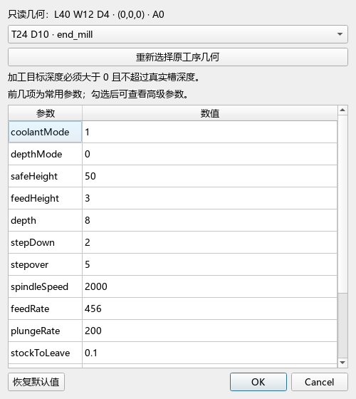
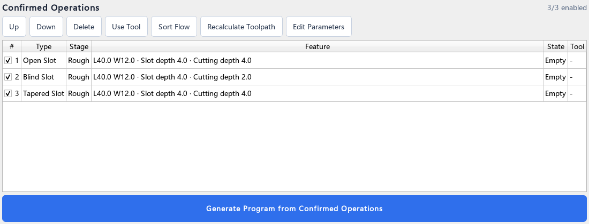

# 槽加工 B2-U 操作完善审核结论

本轮完成槽工序操作反馈修正，保留已有刀路算法、安全门禁和界面风格。代码由实现子线程修改，主对话完成代码、日志、离屏截图和最终NC复核。

## 修正结果

- 编辑目标深度或入刀参数不合法时，保留同一参数窗口的输入和刀具选择，显示具体错误，允许纠正后原ID原位更新一次；取消不写入。
- 工序列表分别显示真实槽深与目标加工深度，中英界面一致；旧数据缺少目标depth时回退真实槽深，不再将相对深度误写成绝对Z。
- 取消几何重选后清除旧“已选槽”摘要，显示尚未确认，与禁用参数及选择按钮一致。
- 编辑会话的初始模型/Setup上下文固定。编辑中切换G55后即使重选原几何，也不能刷新基准并提交；原工序与其它工序保持不变。
- 非OCC轻量Qt测试运行时使用所选Qt/MinGW路径，并在finally恢复应用运行环境；OCC和MainWindow测试仍使用应用部署库。

相对B2-M仅7个文件变化：三个生产文件（SlotOperationController、OperationListPanel、StrategyPanel），三个槽测试及run_tests.ps1。没有更改识别、槽策略、冷却或通信算法。

## 验证证据

新增列表、重选取消及编辑纠错断言先出现真实失败，再修复。追加G55后重选回归也先得到断言失败，修正后通过；未将DLL加载错误当作业务RED。

Windows PowerShell 5.1标准入口的 `slot_workflow_ui_test`、`slot_dimensions_persistence_test`、`slot_operation_edit_test` 全部通过，最终计数3、ENTRY_EXIT=0。同一workflow二进制再次执行通过，PATH恢复断言成立。应用增量make退出0；真实MainWindow的startup及旧程序输出门禁两项记录均为PASS，最终计数2。该主窗口外层进程句柄在中断后不可恢复，因此保留完成日志，不补造外层退出码。构建流水线及参数转发检查退出0。

主审核复查本轮两份最终CQ8程序：入口Z0，目标最低Z为-0.5/-0.3，最大实际入刀角2.999927671°/2.999980292°，槽边界、已扫过下降通道及快速移动检查无失败；运动文本与B2-V已审样例一致。

最终Debug应用SHA256：`a456e33278c9ce247b96acddb3b33e65b69cefe416511205eefd91935d4beec6`，位置为本地 `tmp/slot-b2m-build/debug/CNEXT-CAM.exe`。本轮为增量构建；前置B2-M已完成106对象干净构建及18项相关回归。本轮没有重跑全仓测试。

## 界面复核

以下为真实Qt控件的离屏渲染，使用测试数据，不是桌面操作录屏或3D/实机验收。主审核目视确认错误提示和保留输入可读、取消重选摘要明确、列表目标深度与真实深度分开显示；没有据此宣称完整可访问性认证。

## 真实模型覆盖盘点

主审核另用现有StepImporter和ContourFeatureGrouping实际导入两份既有STEP，模型前后SHA不变，两个探查进程均退出0。没有生成或复制几何冒充真实样本。

| 模型 | 识别特征总数 | 已识别槽 | 同组多成员 |
| --- | ---: | --- | --- |
| WH250852-模板紅色面加工（零件3）.STEP | 2173 | 4个Side straight_slot（索引238–241） | 无 |
| 特征板.STEP | 283 | 2个Front arc_slot（索引32、33）；1个Side straight_slot（索引34） | 无 |

模型SHA256分别为 `7728e246c323c2b4bd9d6bde7066bc90df2e94ced7ad2001d896012c86a1fa50`、`57878dc9d1f6a590dd756a245e0b3d3272aae6752dbd1b1725dc745b34e05541`。分组调用当前真实groupId逻辑，不根据显示名称推断。这些结果证明有后续Side/圆弧槽样本，不证明这些槽已生成合格刀路。真实同组多槽覆盖仍缺样本。

## 保留限制与交付说明

默认PowerShell宿主曾间歇出现 `0xC0000139`，没有定位到具体DLL/符号；PATH隔离后不能声称所有宿主问题已解决。本次明确通过环境为Windows PowerShell 5.1。保留字体目录提示、Qt离屏限制及历史启动停滞未查明根因的说明。

完整本地日志、RED/GREEN、增量补丁、模型JSON与最终来源清单位于 `outputs/slot-b2u/`；不将这些本机运行日志整体上传。GitHub包含代码、固定测试夹具、方案、审核结论及上述三张截图。

更多真实侧面/圆弧/多槽的加工全过程、可见桌面交互、G41控制器建补退补及实机切削尚未验收；线性斜底及已确认不安全G42组合仍保持拒绝。
