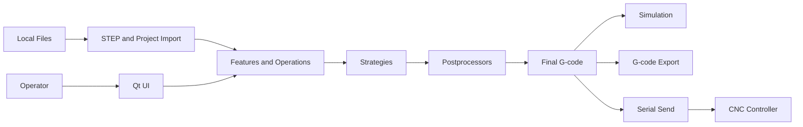

# CNEXT-CAM Threat Model

## Executive summary

CNEXT-CAM is a local Qt/C++ CAM desktop application. The highest-risk themes are integrity and safety of generated G-code, untrusted geometry/project file parsing, and direct serial transmission to CNC equipment. The application is not assumed to be internet-facing, so remote web threats are out of scope; risk concentrates on malicious or malformed local files, unsafe generated programs, and operator mistakes at the machine-send boundary.

## Scope and assumptions

In scope:
- `untitled/src/import`: STEP import and feature recognition.
- `untitled/src/core`: project save/load and application orchestration.
- `untitled/src/strategies`, `untitled/src/postprocessor`: toolpath and G-code generation.
- `untitled/src/simulation`: G-code parsing and preview.
- `untitled/src/ui`: file dialogs, G-code editor, export, and send UI.
- `untitled/src/communication`: serial/DNC transmission.

Out of scope:
- Network services, authentication, multi-user authorization, cloud sync, and CI/release publishing. No evidence of runtime network listeners was found.

Assumptions:
- The software runs as a local desktop application operated by a machinist or programmer.
- STEP, `.cnext`, tool-library JSON, and edited G-code may come from untrusted or semi-trusted local sources.
- The CNC machine trusts bytes sent over serial; there is no protocol-level authentication or cryptographic integrity.
- Generated G-code is safety-critical because wrong coordinates, setup faces, or modal state can damage tools, workpieces, fixtures, or machines.

Open questions:
- Will `.cnext` files or STEP files be exchanged with external customers over email/USB?
- Will the serial-send feature be used in production, or only as an operator-assisted transfer preview?
- Do target CNC controllers require any checksums, handshake, dry-run workflow, or program approval procedure?

## System model

### Primary components

- Qt desktop UI: main workflow, STEP import, project open/save, G-code editing, export, simulation, and machine send. Evidence: `untitled/src/ui/MainWindow.cpp`.
- STEP parser and recognizer: OpenCascade `STEPControl_Reader`, mesh generation, AAG feature recognition. Evidence: `untitled/src/import/StepImporter.cpp`, `untitled/src/import/FeatureRecognizer.cpp`.
- Project persistence: JSON `.cnext` serialization of features, operations, parameters, and generated program snapshots. Evidence: `untitled/src/core/ProjectManager.cpp`.
- Toolpath strategies and postprocessors: operation-specific strategy classes produce blocks, Siemens/Fanuc postprocessors wrap complete programs. Evidence: `untitled/src/strategies`, `untitled/src/postprocessor`.
- Simulation: parses final G-code and renders toolpath. Evidence: `untitled/src/simulation/SimulationController.cpp`.
- CNC communication: serial-port dialog and raw G-code write. Evidence: `untitled/src/ui/CncSendDialog.cpp`, `untitled/src/communication/CncCommInterface.cpp`.

### Data flows and trust boundaries

- Operator -> Qt UI: file paths, selected features, machining parameters, edited G-code; local GUI boundary; no authentication; parameter validation is strategy-specific.
- Local filesystem -> STEP importer: `.step/.stp` files; file boundary; OpenCascade parses geometry; importer catches `Standard_Failure` and missing geometry.
- Local filesystem -> project loader: `.cnext` JSON; file boundary; `QJsonDocument::fromJson` validates JSON syntax, but semantic ranges are mostly accepted as stored.
- Project/strategy state -> postprocessor: features, operations, tools, and parameters; internal boundary; postprocessors add modal setup and shutdown.
- Final G-code -> simulation: text parser boundary; parser interprets G0/G1/G2/G3 and cycles for preview.
- Final G-code -> CNC serial port: raw text over serial; machine boundary; no auth, signing, checksum, or dry-run gate in current code.

#### Diagram

## Assets and security objectives

| Asset | Why it matters | Security objective |
|---|---|---|
| Generated G-code | Directly controls machine motion and modal state | Integrity, availability |
| Machine/workpiece/fixture | Physical damage risk from bad motion or setup | Integrity, safety |
| STEP geometry and recognized features | Drives machining geometry and setup regions | Integrity |
| `.cnext` project files | Persist operations, tool IDs, parameters, and program text | Integrity, availability |
| Tool library and strategy parameters | Wrong tools or feeds create unsafe programs | Integrity |
| Serial port connection | Sends executable machine program | Integrity, safety |
| Operator-facing errors and warnings | Operators rely on them before machining | Integrity, usability |

## Attacker model

### Capabilities

- Provide malformed or malicious STEP files that exercise OpenCascade parsing or feature-recognition edge cases.
- Provide a crafted `.cnext` project with extreme parameter values, mismatched tool IDs, stale G-code snapshots, or wrong setup metadata.
- Modify G-code in the editor before export or serial send.
- Select an incorrect serial port or send stale code if UI state is misleading.

### Non-capabilities

- No assumed remote unauthenticated access to the application.
- No assumed multi-tenant data boundary.
- No assumed ability to bypass the local OS account or directly control hardware outside serial ports exposed to the operator session.

## Entry points and attack surfaces

| Surface | How reached | Trust boundary | Notes | Evidence |
|---|---|---|---|---|
| STEP import | File dialog import | Local file -> OpenCascade parser | Uses `STEPControl_Reader`; malformed geometry can affect parser and feature recognition | `untitled/src/import/StepImporter.cpp::loadStepShape` |
| Project open | File dialog open `.cnext` | Local JSON -> project state | Syntax checked, but semantic values are mostly trusted | `untitled/src/core/ProjectManager.cpp::loadFromFile` |
| Tool library load | Tool-library UI/file paths | Local JSON -> tool definitions | Tool IDs/diameters influence safety | `untitled/src/tool/ToolLibrary.cpp` |
| Strategy parameters | UI and project load | Operator/project -> toolpath generation | Validation exists per strategy but is not centralized | `untitled/src/ui/ParameterEditorDialog.cpp`, `untitled/src/strategies` |
| G-code editor | UI text edit | Operator/project -> final code | Edited text can bypass strategy-level assumptions | `untitled/src/ui/GCodeEditor.cpp` |
| G-code export | File dialog save | Final text -> local file | Writes current editor text | `untitled/src/ui/MainWindow.cpp::onExportGCode` |
| Serial send | Send dialog | Final text -> CNC controller | Raw `toLocal8Bit()` payload written to serial | `untitled/src/communication/CncCommInterface.cpp::sendGCode` |
| Simulation parser | Load final G-code | G-code text -> preview model | Preview correctness affects operator confidence | `untitled/src/simulation/SimulationController.cpp::parseGCode` |

## Top abuse paths

1. Malicious STEP file -> parser succeeds with misleading geometry -> feature recognizer tags wrong setup face -> strategy generates valid-looking G-code -> operator sends program -> machine cuts the wrong face.
2. Crafted `.cnext` -> loads extreme feed/depth/tool parameters -> operator generates batch program -> postprocessor wraps it correctly -> unsafe physical program is exported or sent.
3. Stale generated program snapshot -> project opens with old G-code while operations changed -> operator exports/sends current editor text -> machine runs program that no longer matches visible operations.
4. Hand-edited G-code -> simulation parser misses a modal or cycle behavior -> preview looks acceptable -> serial send transmits unsafe final text.
5. Wrong serial port selection -> program is sent to an unintended controller/device -> unexpected machine state or transfer failure.
6. Large or complex STEP -> expensive tessellation/recognition/simulation -> UI stalls -> operator loses progress or force-closes the application.

## Threat model table

| Threat ID | Threat source | Prerequisites | Threat action | Impact | Impacted assets | Existing controls | Gaps | Recommended mitigations | Detection ideas | Likelihood | Impact severity | Priority |
|---|---|---|---|---|---|---|---|---|---|---|---|---|
| TM-001 | Malicious or malformed STEP file | Operator imports external CAD | Trigger parser/recognizer edge case or misleading topology | Wrong features, wrong setup region, possible crash | G-code, machine, project state | Import catches missing file, transfer failure, `Standard_Failure` | No file-size/complexity guard, no feature confidence report | Add STEP size/face-count budget, import diagnostics, and require operator approval for low-confidence setup regions | Log import face count, feature counts, recognizer warnings | Medium | High | High |
| TM-002 | Crafted `.cnext` file | Operator opens external project | Load unsafe parameter/tool/program state | Unsafe generated or stale G-code | Project, G-code, machine | JSON syntax validation; missing operation IDs regenerated | Sparse semantic validation on load | Validate ranges and tool references on load; mark loaded G-code stale when operations/parameters differ | Project-load validation report | Medium | High | High |
| TM-003 | Operator or malicious project | G-code editor contains text | Bypass strategy checks by editing final G-code | Machine receives unsafe modal/motion commands | G-code, machine | Simulation can parse/show path | No send-time validator or mandatory dry run | Add pre-send G-code validator for modal setup, shutdown, safe-height rapid moves, unsupported commands | Pre-send validation log and warnings | Medium | High | High |
| TM-004 | UI state mismatch | Program snapshots and operation list diverge | Export or send stale editor text | Machine runs different program than visible operations | G-code, project state | Current program ID and snapshots persisted | No freshness hash between operation state and program text | Store source operation hash and show stale badge before export/send | Snapshot hash mismatch warning | Medium | High | High |
| TM-005 | Wrong machine/port selection | Serial ports available | Send program to wrong port/controller | Unexpected machine action or failed transfer | CNC controller | User selects COM port and baud | No confirmation of controller identity | Add optional controller handshake/name display and a final send confirmation with program summary | Record port, baud, bytes, timestamp | Low-Medium | High | Medium |
| TM-006 | Large input file or dense G-code | Operator imports/generates large data | Exhaust UI thread or simulation budget | Denial of service and lost work | Availability, project state | Some simulation collision budget exists in progress history | No general import/project size limits | Add import and project size warnings, async parse/cancel, autosave before long operations | Timing metrics and cancel logs | Medium | Medium | Medium |

## Criticality calibration

- Critical: automatic or silent path to machine-damaging motion without operator-visible warning, such as send-time bypass of setup restrictions or postprocessor output missing safe shutdown.
- High: wrong or stale G-code that can plausibly be exported/sent, malformed external files that misclassify machining faces, or parameter load paths that bypass existing strategy validation.
- Medium: denial of service on large files, misleading but non-silent UI state, or serial transfer failures with clear operator feedback.
- Low: local-only informational leaks, cosmetic text issues that do not affect machining decisions, or issues requiring direct source-code modification.

## Focus paths for security review

| Path | Why it matters | Related Threat IDs |
|---|---|---|
| `untitled/src/import/StepImporter.cpp` | Parses external STEP files and normalizes mesh coordinates | TM-001, TM-006 |
| `untitled/src/import/FeatureRecognizer.cpp` | Converts geometry into machining-critical feature metadata | TM-001 |
| `untitled/src/core/ProjectManager.cpp` | Loads untrusted project JSON into operations, parameters, and program snapshots | TM-002, TM-004 |
| `untitled/src/ui/MainWindow.cpp` | Orchestrates import, generation, snapshots, export, send, and simulation | TM-003, TM-004 |
| `untitled/src/ui/ParameterEditorDialog.cpp` | Enforces first-line numeric validation for strategy parameters | TM-002 |
| `untitled/src/strategies` | Generates machine motion from parameters and features | TM-002, TM-003 |
| `untitled/src/postprocessor` | Adds machine-specific modal setup and shutdown | TM-003 |
| `untitled/src/simulation/SimulationController.cpp` | Preview correctness influences operator trust | TM-003 |
| `untitled/src/ui/CncSendDialog.cpp` | Final operator gate before serial send | TM-003, TM-005 |
| `untitled/src/communication/CncCommInterface.cpp` | Writes raw G-code to machine-facing serial port | TM-005 |
| `untitled/src/tool/ToolLibrary.cpp` | Tool diameters and IDs influence safe generation | TM-002 |

## Recommended next controls

1. Add a pre-send G-code validation pass using the CNC review checklist: modal setup, safe Z before rapid XY, shutdown `M5/M9/M30`, unsupported commands, and setup-face warnings.
2. Add semantic validation when loading `.cnext`: numeric ranges, valid tool IDs, known strategy IDs, nonempty operation IDs, and stale-program detection.
3. Add source-operation hashes to `ProgramEntry` so export/send can warn when current operations no longer match the program text.
4. Add import diagnostics for STEP face count, feature count, recognized setup regions, and low-confidence slot/hole classifications.
5. Add a final send confirmation dialog summarizing postprocessor, work offset, line count, tool list, selected serial port, and validation result.

## Quality check

- Covered discovered runtime entry points: STEP import, project open/save, tool library JSON, G-code editor/export, simulation, serial send.
- Covered each trust boundary in at least one threat.
- Separated runtime desktop behavior from out-of-scope network/CI behavior.
- Proceeded with explicit assumptions because no additional deployment/security context was provided.
- No secrets were encountered.
